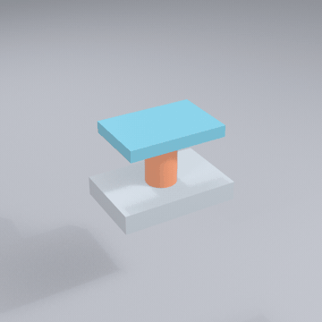
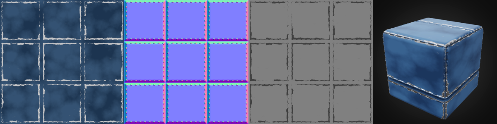

# solidcraft-studio

[](https://github.com/shadowtor/solidcraft-studio/actions/workflows/test.yml) [](LICENSE)

**An Agent Skill that designs 3D models in [SolidCraft](https://solidcraft.io/) through its MCP server, then finishes them for print, render or texturing.** You give it sizes and a description; it models, looks at its own screenshots, and hands back files. Tested with Claude Code. The installer also targets Codex CLI, Gemini CLI and rules-based agents such as Cursor and GitHub Copilot.

 

**Website:** [shadowtor.github.io/solidcraft-studio](https://shadowtor.github.io/solidcraft-studio/)

**Contents:** [Finishes](#the-three-finishes) · [Install](#install) · [Use](#use) · [What was run](#what-was-run) · [Limits](#what-it-will-not-do) · [Develop](#develop) · [Help](#help-and-status) · [Credits](#credits)

## The three finishes

| Finish | What it does | Tools |
|---|---|---|
| **Print** | Fits and minimum walls scaled to the nozzle (0.2, 0.4, 0.6) and filament (PLA, PETG, ASA, Bambu profiles). Slices for the Bambu Lab H2C on the plate you name (cool, supertack, textured cool, engineering, high temp, textured PEI) and reports whether supports are needed | SolidCraft, OrcaSlicer, Bambu Studio profiles |
| **Clean supports** | Designs supports away first (chamfers, orientation, splits). When they stay, uses a solid interface with a gap scaled to layer height and filament, optionally printed in a second filament | `slicer_check.py`, [`clean-supports.md`](skills/solidcraft-studio/references/clean-supports.md) |
| **Render** | Scenes, backdrops, lighting, glass and acrylic, exploded-view animation as PNG, MP4 or GIF. EffectCraft adds titles, 3D layers, camera moves, GPU render and audio | Blender, EffectCraft, ffmpeg |
| **Textured** | PBR maps, projected or UV-mapped, baked, painted, exported as maps or a GLB for vinyl toys and game assets | MaterialCraft, TextureCraft |

Everything optional except SolidCraft: a missing app only disables its finish.

## Install

You need SolidCraft (with `solidcraft-cli`), Python 3.8+ and an agent that reads skills folders. For prints, install OrcaSlicer and Bambu Studio (the H2C profiles come from it).

### A. Claude Code plugin marketplace

```text
/plugin marketplace add shadowtor/solidcraft-studio
/plugin install solidcraft-studio@solidcraft-studio
```

### B. Installer script

```bash
git clone https://github.com/shadowtor/solidcraft-studio.git
cd solidcraft-studio
python tools/install.py --claude --codex      # or --gemini
python tools/install.py --rules               # Cursor, Copilot, Windsurf: run inside your project
python skills/solidcraft-studio/scripts/check_setup.py
```

Other options: `--project`, `--dest <folder>`, `--link`, `--uninstall`. Start a **new session** afterwards. `python tools/package_skill.py` builds `dist/solidcraft-studio.zip`.

### C. Let your AI agent install it

```text
Install the "solidcraft-studio" Agent Skill for me.

1. Clone https://github.com/shadowtor/solidcraft-studio (or git pull if I already have it) and read
   docs/INSTALL-FOR-AGENTS.md in it. Follow that file exactly.
2. Install it for the agent I am using right now. Only copy the skills/solidcraft-studio folder.
3. Run: python skills/solidcraft-studio/scripts/check_setup.py. If it reports a FAIL, show me the line and stop.
4. Tell me where it was installed and that I must start a new session. Do not commit, push or download anything else.
```

## Use

> Design a 60 x 40 mm enclosure base with a lid and four M3 posts, for PETG on a 0.4 mm nozzle, textured PEI plate. Check it in the slicer for the H2C and tell me if it needs supports.

> Make an exploded-view animation of this assembly, 4 seconds, glass lid, on a grey studio floor.

> Texture this figure body with a glossy vinyl material and give me a GLB for Blender.

The skill confirms the finish, nozzle, filament and plate, builds with named parameters so one number rebuilds the part, and reports what it checked and what it did not.

## What was run

Run on Windows with SolidCraft 0.30.1, OrcaSlicer, Blender 5.2.3 and the Craft apps, details in the [references](skills/solidcraft-studio/references):

- **Slicing:** the H2C with 0.2, 0.4 and 0.6 mm nozzles, six plates with different bed temperatures, and PLA, PETG and ASA. A ledge part needs supports. A plain block does not.
- **Clean supports:** the tight-interface preset slices. A second filament as the interface slices as an estimate: the command-line slicer needs its prime tower turned off, so set tower, purge and nozzle assignment in Bambu Studio for a real print.
- **Render:** headless and live Blender, Cycles glass, MP4 and GIF.
- **Textures:** MaterialCraft maps, triplanar projection, UV projection, baking, painting, decals and a GLB opened in Blender.
- **Effects:** EffectCraft MP4 with a title and vignette, GPU render, 3D layers, a camera move and AAC audio.

**Not proven:** a real print (the only proof the fit offsets and support settings hold on your printer), Unreal and Unity import, EffectCraft's live-app bridge, `.mcmat` sharing between MaterialCraft and TextureCraft.

## What it will not do

- Promise a print will match the slice. Treat the numbers as starting points and print a fit coupon.
- Send anything to a printer.
- Work without SolidCraft installed. Each MCP server only sees the folder it is given.
- Fix SolidCraft's own limits: its OBJ export has no UVs (the skill adds them in Blender) and no GLB export.

## Develop

```bash
python tools/smoke_test.py          # static checks, runs anywhere
python tools/package_skill.py       # dist/solidcraft-studio.zip
python tools/build_site.py          # _site/, then: python -m http.server -d _site 8000
```

See [`CONTRIBUTING.md`](CONTRIBUTING.md).

## Help and status

Questions and bugs go in [issues](https://github.com/shadowtor/solidcraft-studio/issues). This is a one-person project in active use, so expect a reply within a week or so. Security problems: [`SECURITY.md`](SECURITY.md). Everyone taking part follows the [code of conduct](CODE_OF_CONDUCT.md).

## Credits

Built for [SolidCraft](https://solidcraft.io/) by Tangency Labs, and the Craft apps [MaterialCraft](https://github.com/storytold/materialcraft), [TextureCraft](https://github.com/storytold/texturecraft) and [EffectCraft](https://github.com/storytold/effectcraft). Slicing uses [OrcaSlicer](https://github.com/OrcaSlicer/OrcaSlicer) with Bambu Studio's profiles; support research is sourced in [`clean-supports.md`](skills/solidcraft-studio/references/clean-supports.md). The web viewer uses Google's [`<model-viewer>`](https://modelviewer.dev/) (Apache 2.0). The skill structure follows the sibling `fusion-studio` and `blender-studio` skills. Not affiliated with any of these projects or with Bambu Lab.

MIT licence, see [`LICENSE`](LICENSE).
